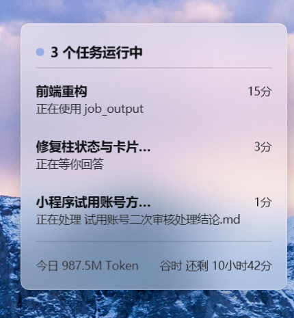
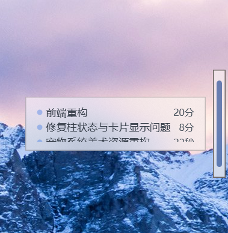
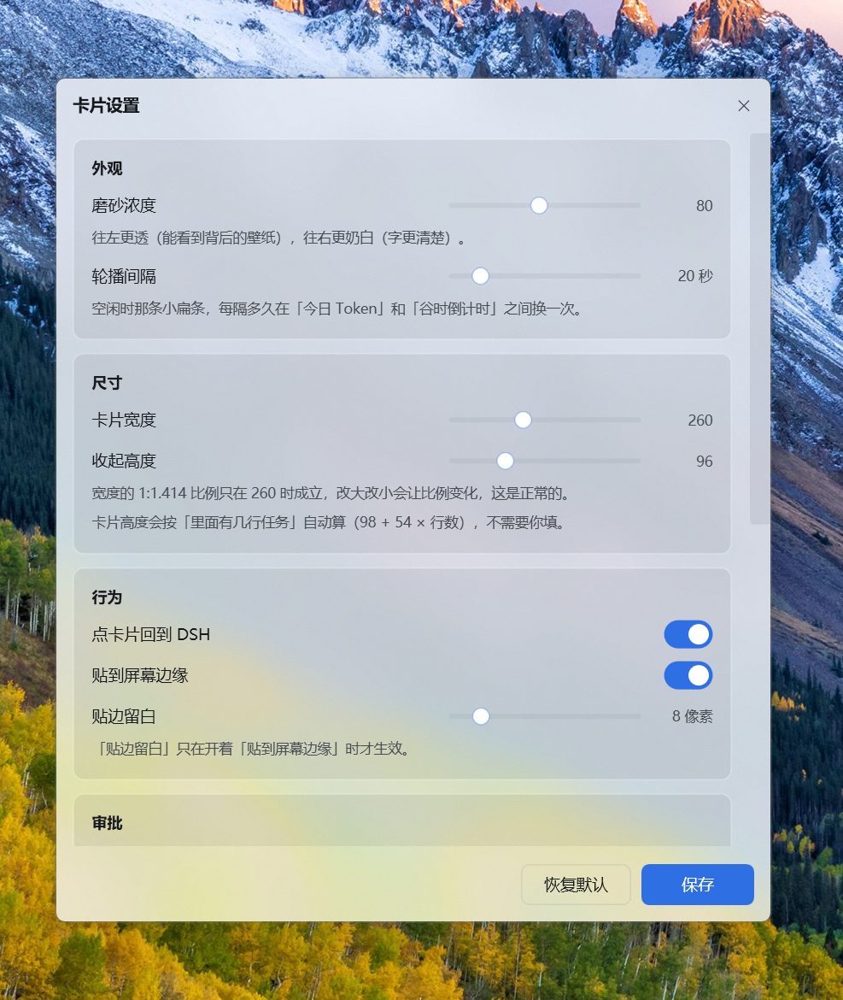
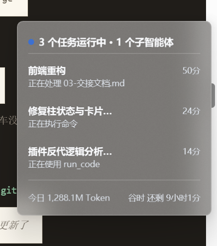

# dsh-floating-window · DSH 状态悬浮窗


**一块浮在桌面上的磨砂玻璃小窗，实时告诉你 DSH 正在干什么。  
不做花哨皮肤，只从实用性出发，简单有时就是最好的。**

不切窗口、不打断手上在做的事 —— 抬头扫一眼就知道：

- 现在有几个任务在跑、每个任务跑到第几分钟、正在处理什么文件、  
  **这个任务已经烧掉多少 Token**
- 有没有**等你审批**的事（要执行删除、改系统之类操作时会停下来问你）
- 今天已经用掉多少 Token、距离「谷时」结束还有多久  
  （谷时是 DeepSeek 的低价时段，同样用量更便宜；  
  时间段是工作日的 9-12 点、14-18 点之外，加上周末和法定节假日全天，  
  插件会自己判断，节假日也从网上自动更新，不用你填）

> **⚠️ 只支持 Windows 10 / Windows 11。** 在 Mac 和 Linux 上装得上、但卡片不会出现。  
> 原因见下面「[先看这里：仅支持 Windows](#先看这里仅支持-windows)」。



不想让卡片占地方的时候，右键点「缩成细条」，它就变成一根**细柱**贴在屏幕边缘，  
几乎不占位置；鼠标移上去才弹出气泡，看一眼就走。




---

## 先看这里：仅支持 Windows

**这个插件只能在 Windows 10 / Windows 11 上工作。**

窗口本体是用 **PowerShell + WPF**（Windows 自带的界面技术）画出来的真·磨砂玻璃窗口，  
用到了只有 Windows 才有的系统能力。

在 macOS / Linux 上会发生什么：

- 插件本身**会正常加载**，不报错，DSH 看起来一切正常
- 但**卡片永远不出现**
- 插件日志里只有一句 `两种启动策略都没成功。请手动跑 panel\run-panel.bat 看报错。`

这句话对不熟悉的人完全没有帮助，所以在这里先写死：  
**看不到卡片，先确认你在 Windows 上。**

---

## 这份说明怎么读

两类人看的东西不一样，可以只挑自己需要的：

**想用这个插件的人**（不需要懂代码）

1. [安装](#安装) —— 三条命令，选一条
2. [怎么用](#怎么用) —— 鼠标点什么、设置在哪、柱态怎么用
3. [卸载](#卸载) 和 [问题反馈](#问题反馈) —— 不用了怎么办、出问题找谁

**想改这个插件的开发者**（Node.js + PowerShell）

1. [为什么这样分工](#为什么这样分工) —— 整体架构，先看这个
2. [数据在哪](#数据在哪) / [`state.json` 字段](#statejson-字段) —— 插件和卡片的接口
3. [数据来源](#数据来源全部经实测验证) —— 每个字段来自哪个事件
4. [拉起策略](#拉起策略踩过的坑) —— 一堆踩坑记录，改代码前必看
5. [开发](#开发) —— 怎么跑测试、怎么检查语法

后面还写着 [配置](#配置)、[调试](#调试)、[开发状态](#开发状态)。

---

## 安装

**已经发布到 npm 了**：<https://www.npmjs.com/package/dsh-floating-window>

下面三种方式任选一种，效果一样。

> **`<你的 profile>` 是什么？**  
> `profile` 就是"插件装到哪个配置夹里"的名字。  
> 打开 DSH，侧栏点「插件」，页面上能看到当前 profile 的名字。  
> 不确定就随便用一个你在用的名字，DSH 会在第一次使用时自动建好它。

### 方式一：命令行，从 npm 装（推荐）

```bash
dsh plugin --profile <你的 profile> add dsh-floating-window@0.10.11
```

> ⚠️ **这条命令里的版本号必须写精确的**（`@0.10.11` 这种），不能只写包名。
>
> 原因：pnpm 11 有个「新版本等待期」机制（`minimumReleaseAge`，默认 **1440 分钟 = 1 天**）。  
> 一个版本发布后不到这个时间，pnpm 会认为它"太新、还在观察期"而**不去装它**。  
> 而你只写包名时，安装范围是"任意版本"，pnpm 就**默默往下退到某个老版本**，  
> 而且**退出码是 0** —— 命令行上看不出任何异常，看起来完全成功。
>
> 结果就是你装了、没报错，实际跑的是旧版，出问题能查很久。  
> 写上精确版本号就没有"往下退"的空间了，只能装这一版（或者明确报错），  
> 不会出现"看着成功其实装错"。
>
> 另一种办法：把包名加进 profile 的 `pnpm-workspace.yaml` 的  
> `minimumReleaseAgeExclude` 列表里，让它不受这个等待期限制。  
> 那个文件里本来就有一串这样的例外（都是之前手加的），照着加一行  
> `- dsh-floating-window` 就行。

### 方式二：命令行，从 GitHub 装（不用 npm 的备选）

```bash
dsh plugin --profile <你的 profile> add github:Windpixy/dsh-floating-window
```

> 这条路装的是仓库里的最新代码，没有版本号概念。网络访问 GitHub 慢的时候可以优先用方式一。

### 方式三：在 DSH 图形界面里装

不想敲命令也可以：

1. 打开 DSH，左侧栏点 **「插件」**
2. 点 **「添加插件」**
3. 在输入框里填下面任意一种：
   - **包名**：`dsh-floating-window@0.10.11` ← 推荐
   - **Git 地址**：`github:Windpixy/dsh-floating-window`
   - 打包好的压缩包路径
   - 本地文件夹的绝对路径（自己改了代码想试效果时用这个）

装好后**重启一次 DSH**，卡片会自动出现在屏幕右侧（默认位置，之后它自己记住你拖动过的地方）。

### 装完之后你应该看到什么

- 屏幕右侧出现一块磨砂玻璃卡片（不是纯色方块 —— 能透出背后的壁纸）
- 有任务在跑时，卡片上按行列出任务名、已跑时间、正在做什么，  
  以及**这个任务已经用掉的 Token**（右下角小字，像 `12.3k Token`）
- 没有任务时，卡片缩成一行，轮流显示「今日 Token」和「谷时倒计时」


**如果什么都没出现**：先确认是 Windows，再打开插件日志  
`%USERPROFILE%\.dsh\desktop-card\plugin.log`，最后的手段是手动双击  
`面板目录\panel\run-panel.bat`，它会用控制台窗口启动卡片，报错能直接看到。

### 以后怎么更新

重跑一次安装命令就行（GitHub 方式会去拉最新代码，npm 方式把版本号换成新的）：

```bash
dsh plugin --profile <你的 profile> add github:Windpixy/dsh-floating-window
```

更新完重启 DSH。如果卡片还在屏幕上、没跟着更新，它会**自己发现跑的是旧代码并重启一次**  
（机制见下面「改了代码，卡片会自动重启」），不用手动去关它。

如果命令提示"已经装过了"，先 remove 再 add：

```bash
dsh plugin --profile <你的 profile> remove dsh-floating-window
dsh plugin --profile <你的 profile> add github:Windpixy/dsh-floating-window
```

---

## 卸载

```bash
dsh plugin --profile <你的 profile> remove dsh-floating-window
```

> ⚠️ **卸载插件不会关掉已经开着的卡片窗口。**
>
> 卡片是一个**脱离了 DSH 进程树的独立常驻进程**（这是故意的：这样你关掉 DSH，  
> 卡片还能留着）。所以"删插件"和"关窗口"是两件事。
>
> 卸载之后请**右键卡片 → 退出**，否则那块窗口会一直飘在桌面上，  
> 而且因为插件已经卸了，它读不到新数据，会一直停在最后一帧。

卸载只删程序，不删你的数据。想连设置和日志一起清掉，手动删这个文件夹：

```
%USERPROFILE%\.dsh\desktop-card\
```

---

## 怎么用

### 鼠标操作

| 操作       | 效果                                                            |
| -------- | ------------------------------------------------------------- |
| **单击卡片** | 跳回 DSH 主窗口                                                    |
| **拖动卡片** | 移动位置，松手会记住；开着"贴边"时会自动吸附到屏幕边缘                                  |
| **右键卡片** | 打开菜单：设置… / 置顶 / 回到 DSH / 缩成细条 / 回到默认位置 / 重新读取设置 / 导出诊断包… / 退出 |

### 设置界面

右键卡片 → **设置…**，打开的就是下面这个窗口。拖滑块 → 点「保存」，  
卡片会在半秒内自己套用新设置，**不用重启 DSH，也不用关掉卡片**。



界面上能改的东西：

| 分组 | 项目            | 说明                                                 |
| -- | ------------- | -------------------------------------------------- |
| 外观 | 磨砂浓度（24~144）  | 往左更透（看得见壁纸）、往右更奶白（字更清楚）                            |
| 外观 | 轮播间隔（5~120 秒） | 空闲小扁条在「今日 Token」和「谷时倒计时」之间多久换一次                    |
| 尺寸 | 卡片宽度（200~360） | 默认 260                                             |
| 尺寸 | 收起高度（72~160）  | 空闲收缩后的高度，默认 96                                     |
| 行为 | 点卡片回到 DSH     | 开关；关掉后点卡片没反应                                       |
| 行为 | 贴到屏幕边缘        | 开关；拖动松手自动吸附                                        |
| 行为 | 贴边留白（0~60 像素） | 只在上面那个开关开着时有效                                      |
| 审批 | 在悬浮窗上直接审批     | **默认关**，安全原因见下面「[审批相关的两个开关](#审批相关的两个开关安全相关请看完再打开)」 |
| 审批 | 点「允许」前再确认一次   | 默认开，防止误点                                           |
| 峰谷 | （只读）          | 显示当前是不是谷时、判断规则是什么，不用你填                             |
| 状态 | （只读）          | 卡片在不在跑、DSH 地址有没有同步成功，排查时看这一块                       |

### 任务行上的 Token 数字

每个任务行的**右下角**会显示这个任务**已经用掉多少 Token**，格式像 `12.3k Token`。

```
┌────────────────────────────────────┐
│ 账号体系1期                  4秒  │  ← 任务名 + 已跑时长
│ 正在运行              12.3k Token  │  ← 正在做什么 + 这个任务的 Token
└────────────────────────────────────┘
```

几个需要注意的地方：

- **这是「这个任务」的用量，不是「今日总量」**。底部那行的「今日 XXX Token」是全天合计。
- **包含子代理**。如果一个任务派了子代理去干活，子代理用掉的 Token 也算在这个任务名下  
  （因为子代理是独立会话，不合并的话，会出现"底部写今日 3M、任务行只有 1.5k"的错觉）。
- **数字为 0 时不显示**，不会写 `0 Token` —— 那看起来像"这个任务真的一点都没用"，  
  但更可能是这条数据还没到。
- 跨天会归零（跟底部「今日」同一个口径）。

> 这个数字来自插件按会话统计的 Token 账本，卡片每 500ms 跟着主循环刷一次，不用手动刷新。

### 柱态（细柱）

右键 → **缩成细条**，卡片变成一根 14×120 像素的柱子贴在屏幕边缘。

柱子只有一条色条，看颜色就知道现在是什么状态：

| 色条颜色 | 意思          |
| ---- | ----------- |
| 🔵 蓝 | 有任务正在跑      |
| 🔴 红 | 有事在**等你审批** |
| 🟢 绿 | 刚刚有任务完成     |
| ⚪ 灰  | 空闲          |

- 任务跑起来时，色条会像呼吸一样明暗起伏 —— 一眼区分"在跑"和"卡住了"
- **单击柱子**展开回卡片
- **鼠标悬停**弹出一个小气泡，显示每个任务的名字和已跑时长（就是上面那张气泡图）
- 拖动柱子可以换边、换上下位置，松手自动吸附到屏幕边缘

### 深色壁纸下会自动换配色

卡片会读取背后壁纸的明暗，自动把文字从黑色换成白色，保证看得清。  
不用你手调。



### 更多状态

任务多的时候卡片会自动长高（最多 5 行），子智能体也单独计数；  
只有一个任务时，标题行直接显示「正在运行」；  
同一时刻有多个会话在跑时，每行一个任务，各带自己的计时。

这些状态的截图都收在 [docs/screenshots.md](docs/screenshots.md)。

---

## 它长在 DSH 的哪儿

下面是 DSH 主界面，卡片浮在屏幕右侧。你可以一边看 DSH 的用量统计，一边看卡片上的实时任务。


---

## 为什么这样分工

窗口本体是一个独立的磨砂玻璃容器（PowerShell + WPF），打包在插件的 `panel/` 里。  
插件只负责两件事：

1. **把 DSH 的真实状态写进 `state.json`** —— 窗口每 500ms 读一次
2. **DSH 启动时把窗口拉起来** —— 窗口自己有单实例保护，不会开出两个

```
DSH 启动
  └─ 加载 dsh-floating-window 插件
       ├─ 监听会话事件 → 汇总成窗口要的状态
       ├─ 写 state.json（节流 + 原子替换）
       └─ 拉起窗口进程（尽量脱离 DSH，DSH 关了窗口不跟着关）
            └─ 窗口每 500ms 读 state.json（窗口侧逻辑不用改）
```

这样拆的好处：

- 插件挂了最多数据不更新，窗口不会跟着崩
- 调试极简单：直接打开 `state.json` 就知道插件有没有在干活
- 窗口侧不用懂 DSH 的事件，只认一个 JSON 文件

---

## 目录结构

```
dsh-floating-window/
├── index.js            插件入口
├── lib/
│   ├── state.js        纯逻辑：事件 → 状态
│   ├── tokens.js       今日 Token 账本（回填去重）
│   ├── sources.js      接 DSH 事件
│   ├── writer.js       原子写盘 + 节流
│   ├── launcher.js     拉起卡片（双策略自适应）
│   ├── paths.js        目录约定与配置默认值
│   ├── logger.js       日志
│   ├── valley.js       峰谷时段判断（含节假日自动更新）
│   ├── endpoint.js     解析 DSH 的实际地址
│   ├── approval-proxy.js  悬浮窗审批（默认不接管）
│   └── demo.js         假数据（开发调试用）
├── panel/              卡片本体（PowerShell + WPF）
│   ├── Panel.ps1       主程序
│   ├── PanelVisual.ps1 界面
│   ├── Settings.ps1    图形化设置
│   ├── settings.json   默认配置
│   └── run-panel.bat   手动启动（不用 DSH 时）
├── scripts/
│   ├── check-panel-syntax.ps1   用 PS 5.1 解析器验证卡片脚本
│   ├── check-package.ps1        校验打包文件外形（BOM / 行尾）
│   └── fix-bom.ps1              给 panel 下的 .ps1 补回 BOM
├── docs/               截图（README 引用的图都在这里）
│   └── screenshots.md  完整截图集
├── test/               单测与验收脚本（只在源码仓库里）
└── locale/ icon.svg
```

> `test/` 目录**不包含在 npm 包里**（`package.json` 的 `files` 白名单没列它）。  
> 所以下面「开发」章节里的测试命令，**只对从 GitHub clone 下来的源码仓库有效**。  
> `docs/` 里的截图同样没进 npm 包 —— 这份说明以 GitHub 为主场，  
> 在 npm 页面上看时图可能是坏的，不影响插件本身。

---

## 数据在哪

程序和运行数据是分开放的，这样插件目录永远干净、能直接进版本库：

- **程序**在插件的 `panel/` 里，跟着插件一起升级
- **数据**在 `%USERPROFILE%\.dsh\desktop-card\`

| 文件               | 作用                                      |
| ---------------- | --------------------------------------- |
| `state.json`     | 插件写、卡片读的状态                              |
| `panel-pos.json` | 卡片位置记忆                                  |
| `heartbeat.json` | 卡片每 2 秒报告"我还活着 + 进程号 + 窗口句柄 + 加载的代码时间戳" |
| `tokens.json`    | 今日 Token 缓存                             |
| `plugin.log`     | 插件日志（超过 1MB 自动轮转）                       |
| `settings.json`  | 卡片的外观配置（首次启动从 `panel/` 复制）              |
| `holidays.json`  | 节假日缓存（从网上拉取后落盘，断网也能用）                   |
| `decisions/`     | 悬浮窗审批的「决定文件」目录（v0.8.0 起）                |

所以插件目录里没有运行数据，`git status` 永远是干净的。

> 注：数据目录叫 `desktop-card` 是历史原因 —— 插件以前叫 `dsh-desktop-card`。  
> 改名时**故意没改数据目录**，这样老用户的设置、位置记忆、日志全都还在，不需要迁移。

---

## `state.json` 字段

这是插件写给卡片的完整协议，就下面这些：

```json
{
  "updatedAt": 1793114411,
  "tasks": {
    "running": 2,
    "sessions": [
      { "title": "重构登录模块", "elapsedSec": 431, "activity": "正在处理 auth.ts", "tokens": 12340 }
    ]
  },
  "approval": {
    "pending": 1,
    "items": [ { "title": "删除 3 个临时文件" } ]
  },
  "lastFinished": "20261027151958",
  "tokens": { "today": 12300 }
}
```

- `tasks.sessions` 可省略；卡片缺字段时显示"N 个任务运行中"
- `sessions` 超过 5 条时第 5 行变"还有 N 个"
- `lastFinished` 为空或 `null` = 没有刚完成的任务
- `tasks.sessions[].tokens` 是**这个任务（含它派生的子会话）今天用掉的 Token**，  
  卡片画在行右下角。v0.10.0 起才有；老版本的 `state.json` 里没这个字段，卡片会自动不显示。

---

## 配置

### 插件侧配置

在 profile 的 `cordis.patch.yml` 的 `config` 里改，**改完要重启 DSH**：

| 键                      | 默认                                | 说明                              |
| ---------------------- | --------------------------------- | ------------------------------- |
| `autoLaunch`           | `true`                            | DSH 启动时自动拉起卡片                   |
| `showSubagentSessions` | `false`                           | 子代理会话是否也显示为任务                   |
| `maxTaskRows`          | `5`                               | 卡片最多显示几行。注意卡片侧目前写死上限 5，这个键暂时不生效 |
| `writeThrottleMs`      | `500`                             | `state.json` 最快写入间隔             |
| `backfillTodayTokens`  | `true`                            | 启动时回填今天已用的 Token                |
| `heartbeatStaleMs`     | `8000`                            | 心跳多久没更新算卡片已退出                   |
| `useDemoData`          | `false`                           | 演示模式：用假数据轮流切换五种状态               |
| `dataDir`              | `%USERPROFILE%\.dsh\desktop-card` | 数据目录                            |
| `panelDir`             | 插件内的 `panel/`                     | 卡片程序目录（一般不用改）                   |

示例：

```yaml
- id: dsh-floating-window
  name: dsh-floating-window
  config:
    autoLaunch: true
    showSubagentSessions: false
```


### 卡片外观设置放哪

上面那张表是**插件侧**配置。**卡片长什么样、在不在悬浮窗上直接审批**，在另一个地方：

- 平时：卡片上右键 → **设置…**，打开图形化设置窗口
  （磨砂窗口，能改磨砂浓度、轮播间隔、卡片宽度、收起高度、贴边、审批开关）
- 底层文件：`%USERPROFILE%\.dsh\desktop-card\settings.json`
  （首次启动从 `panel/` 复制一份；改它之后卡片 500ms 内自动套用，**不用重启**）

### 审批相关的两个开关（安全相关，请看完再打开）

| 键 | 默认 | 说明 |
|---|---|---|
| `approvalInline` | `false` | 悬浮窗上是否直接给「允许 / 拒绝」按钮。**默认关** —— 审批是安全闸门，开了就等于允许本机程序替你做审批决定，应该由用户显式打开 |
| `approvalConfirm` | `true` | 点「允许」前是否二次确认。只在 `approvalInline: true` 时有意义 |

> 这两个键的**真源是数据目录里的 `settings.json`**，不是 `lib/paths.js` 的 `DEFAULTS`。
> `DEFAULTS` 只是"文件里缺这个键时的兜底"。插件按文件 mtime 判断变化，
> 所以在设置界面里改了之后，插件那边不用重启 DSH 就能读到。

---

## 数据来源（全部经实测验证）

卡片上每一位数字都不是猜的，全部来自 DSH 自己的事件：

| 卡片显示 | 数据源 |
|---|---|
| 有几个任务在跑 | `api-session/status`（开跑/停跑）、`api-session/added`（出现） |
| 任务标题 | `session/title` 事件；回填时从会话日志翻，另有标题缓存 |
| 跑了多久 | 开跑时记时间戳，现算 |
| 正在做什么 | `tool/call` 事件，工具名翻中文 + 抠文件名 |
| **任务行右下角的 Token** | `assistant/message.usage` 按 `sessionId` 分别累加（**含子代理**），v0.10.0 起 |
| 待审批 | `approval/asked` / `approval/decided` 事件 |
| 今日 Token | `assistant/message.usage` 累加 + 启动时回填 |
| 刚完成绿点 | 会话从跑变停的那一刻 |

### 关于审批接管

v0.8.0 起改成了「成为 `approval/request` 瀑布的一个 answerer」。两个要点：

1. **绝不 `prepend: true`** —— 那个位置被 `@xmanrui/dsh-im` 占着，
   抢到它前面会让 dsh-im 再也拿不到审批。我们用普通 `{ global: true }`，排在它后面。
2. 默认**不扣住**审批（`approvalInline: false`）：answerer 一进来就 `next()` 让路，
   行为和"没有这个插件"完全一样。只有用户在设置界面里显式打开
   「在悬浮窗上直接审批」，才会真正攥住审批、等卡片上的点击。

分工：`approval/asked` / `approval/decided` 负责**显示**（卡片上"有 N 项待你审批"），
`approval/request` 负责**接管**（把审批扣下来等卡片决定）。

### 关于 Token 口径

用的是 `inputTokens + cacheReadTokens + outputTokens`。

为什么不只算 `input + output`：那样会**差 45 倍**。长对话的历史上下文全走缓存，
`inputTokens` 只有几千，而 `cacheReadTokens` 有几亿。漏掉缓存读取，
卡片上的数字会小得离谱。详见 `lib/sources.js` 的 `usageAmount()`。

---

## 拉起策略（踩过的坑）

`lib/launcher.js` 用**双策略自适应**：

1. 先试 `detached: true`（脱离 DSH 进程树，DSH 退出时卡片能留着）
2. 等 6 秒没心跳，退回 `detached: false`（保证至少能显示出来）

之所以要自适应：实测在某些环境里 `detached: true` 启动的 PowerShell 会秒退，
连心跳都写不出来；同一份命令换 `detached: false` 就完全正常。
用了哪种会写进日志。

另外两个坑：

- **路径有空格**：`-File` 参数必须单独作为一个 argv 项传（用参数数组），不能拼字符串
- **别设 `windowsHide: true`**：实测会让 WPF 窗口被系统当成"应该隐藏"而不显示

### 改了代码，卡片会自动重启（v0.9.12 起）

卡片是**脱离 DSH 进程树的常驻进程**，所以 DSH 重启**不会**连带它重启。
`.ps1` 是进程启动时一次性读进内存的，改文件之后运行中的进程不会重新加载。

这导致过一个很难查的问题：改了代码、以为重启了，
其实跑的还是几十分钟前的旧代码 —— 没有报错、日志正常、
现象和"新功能写错了"一模一样。

现在插件会自己处理：

1. 卡片每 2 秒写心跳，带上 `scriptStampMs`（**进程启动那一刻** `Panel.ps1` 的时间戳）
2. 插件每 5 秒比一次：心跳里的时间戳 vs 磁盘当前 mtime
3. 落后超过 2 秒 → 判定为旧代码 → 结束旧进程 → 重新拉起

安全措施（都在 `lib/launcher.js`，纯函数、有单测）：

| 措施 | 为什么 |
|---|---|
| `autoLaunch: false` 时绝不重启 | 用户明确关了自动拉起，就不能动他的卡片 |
| 最多重启 2 次 | 防止"杀→拉→还是旧→杀"的死循环让窗口一直闪 |
| 同一版本只重启一次 | 去重键是旧版本的时间戳，不是次数 |
| 老版本卡片（心跳无该字段）不判旧 | 否则升级瞬间会误杀每个用户的卡片 |
| 磁盘时间读不到就不判断 | 宁可不动，也不凭猜去杀进程 |

---

## 问题反馈

遇到 bug、有想法、想加功能，去 GitHub 提 issue（中文就行）：

**https://github.com/Windpixy/dsh-floating-window/issues**

提之前建议先看一眼插件日志，把里面相关的几行贴进 issue，能省掉一半来回：

```
%USERPROFILE%\.dsh\desktop-card\plugin.log
```

卡片上右键还有 **「导出诊断包…」**，会把当前状态、心跳、设置、日志打成一个包，
直接拖进 issue 也可以（**注意里面可能含你的任务标题，介意就自己看一眼再发**）。

---

## 调试

插件日志：`%USERPROFILE%\.dsh\desktop-card\plugin.log`

卡片自己的日志（设了 `DSH_PANEL_DEBUG=1` 才有）：
`%USERPROFILE%\.dsh\desktop-card\panel-debug.log`

卡片手动启动（不走 DSH）：

```bash
panel\run-panel.bat
```

验证卡片脚本语法（**必须用 PowerShell 5.1**，PS 7 会漏掉编码问题）：

```bash
powershell.exe -NoProfile -ExecutionPolicy Bypass -File scripts\check-panel-syntax.ps1
```

随时可跑的排查工具 —— 一条命令回答"卡片跑的是不是磁盘上这版代码"：

```bash
node test/check-card-staleness.mjs
```

三种结论：✅新鲜 / ⚠️过旧 / ❔无法判断。

**改了代码却"没效果"时，先跑这个，再查代码。**

> 这个脚本在 `test/` 里，所以**只在源码仓库里能用**（npm 包里没有 `test/`）。
> 从 npm 装的用户遇到"卡片是旧版"，直接右键卡片 → 退出，让它被重新拉起一次就行。

---

## 开发

> ⚠️ **以下命令只对源码仓库有效。**
> `test/` 目录不在 npm 包里（`package.json` 的 `files` 白名单没包含它），
> 所以从 npm 装的人照抄会得到"文件不存在"。想跑测试请先 clone 仓库。

### 跑测试

纯逻辑单测，**不需要 DSH、不需要重启**：

```bash
node test/unit.mjs              # 状态换算 74 项
node test/tokens.mjs            # Token 账本（含按会话统计）35 项
node test/launcher.mjs          # 拉起判断 + 崩溃识别 83 项
node test/valley.mjs            # 峰谷算法 76 项
node test/endpoint.mjs          # 地址解析 77 项
node test/writer-race.mjs       # 原子写盘竞争 7 项
node test/plugin-wire.mjs       # 插件接线 21 项
node test/revive-e2e.mjs        # 崩溃后自动恢复 10 项
node test/approval-proxy.mjs    # 悬浮窗审批代理 85 项
node test/bar-mode.mjs          # 柱态界面 339 项
node test/freshness.mjs         # 旧代码检测 + 自动重启判据 24 项
node test/logger.mjs            # 日志轮转与去重 91 项
node test/staleness-chain.mjs   # 旧代码检测整链（含字段传递）20 项
node test/restart-window.mjs    # 重启空窗检测 28 项
node test/c4-async.mjs          # 情况不明复查不阻塞主线程 13 项
```

合计 **983 项，全部不需要 DSH**。

> 上面的项数是写这份文档时实测的。**判断标准永远是「失败 0」，不是「正好 983」**——
> 每加一个功能这个总数就会变，别拿它当验收依据。

**另外还有一个测量脚本**（不是断言测试，用来量化阻塞时长）：

```bash
node test/c4-blocking-measure.mjs
# 输出各场景下主线程的停顿毫秒数，退出码 0 即正常
```

懒得一条条敲，可以一把跑完（PowerShell）：

```powershell
foreach ($f in 'unit','tokens','launcher','valley','endpoint','writer-race',
               'plugin-wire','revive-e2e','approval-proxy','bar-mode',
               'freshness','logger','staleness-chain','restart-window','c4-async') {
  Write-Host "=== $f ===" -ForegroundColor Cyan
  node "test/$f.mjs"
}
```

每个套件最后两行应该是 `通过 N   失败 0` 和 `全部通过 ✅`。

需要真卡片的（会自己起一张、杀掉、看它能不能回来，用的是**独立数据目录**，不动你自己那张）：

```bash
node test/revive-real-card.mjs    # 真卡片崩溃恢复 10 项
```

改完 JS 想快速查语法，不用跑测试：

```bash
node --check index.js
```

### 改完代码建议都跑一遍的外形 / 语法检查

```bash
powershell -NoProfile -ExecutionPolicy Bypass -File scripts/check-package.ps1
powershell -NoProfile -ExecutionPolicy Bypass -File scripts/check-panel-syntax.ps1
powershell -NoProfile -ExecutionPolicy Bypass -File scripts/fix-bom.ps1    # 修 BOM
```

为什么单独有这几个脚本：这几个 `.ps1` 里有大量中文，
PowerShell 5.1 **没有 BOM 就按系统 ANSI（GBK）解码**，中文变乱码、整份脚本解析失败；
而 `package.json` 带 BOM 会让 DSH 直接读不进去、插件静默不加载。
这类问题**内容看起来完全正确，坏在字节层面** —— 编辑器和 `node --check` 都发现不了，
只能靠脚本只看字节。

### 需要 DSH 开着的验收

```bash
powershell -NoProfile -STA -ExecutionPolicy Bypass -File test/verify-open-dsh.ps1   # 点卡片回 DSH
powershell -NoProfile -STA -ExecutionPolicy Bypass -File test/m4-acceptance.ps1     # 布局/磨砂/内存
```

---

## 开发状态

- [x] M0 探针：七个数据源可行性验证
- [x] M1 骨架：纯逻辑 + 原子写盘 + 假数据打通管道
- [x] M2 接真实数据（Token 与官方账本 0 误差）
- [x] M3 卡片打包进插件 + 自动拉起
- [x] M4 完整验收（六档高度 / 磨砂 / 内存 / 五种状态 全通过）
- [x] M5 打包发布（git 仓库 + 干净环境安装验证）

上线后修过的实测问题（按发现顺序）：

| 轮次 | 现象 | 真实原因 |
|---|---|---|
| 一 | 峰谷要手填；点卡片开空白网页 | 峰谷改为自动拉节假日；打开方式改用窗口激活 |
| 二 | 点卡片没反应；底部文字偏上 | `dsh://` 不会激活已有窗口；行高分配错 6 像素 |
| 三 | 点卡片后卡片凭空消失 | 定时器读不到函数局部变量，异常崩掉整个进程 |
| 四 | 卡片根本不出现 | `package.json` 带 BOM，插件没被 DSH 加载 |
| 五 | 卡片消失后**永不恢复**（睡眠唤醒触发） | `detached` 启动白等 6 秒；睡眠唤醒被误判成卡片崩溃 |
| 六 | 卡片消失后**永不恢复**（心跳读不到触发） | 心跳文件读不到时被当成"用户主动关了"，于是不再拉起 |
| 七 | 睡醒后日志误报"卡片崩溃" | 措辞在复查之前就下结论，实际只是睡眠 |
| 八 | 打开 DSH 时先闪一张纯黑卡片 | 窗口首帧还没就绪就显示出来了 |
| 九 | 卡片抓屏失败（两种不同形态） | 抓屏时机与重试逻辑，两种情况要分别处理 |
| 十 | **自动"旧代码检测"失效**，改了代码不重启卡片 | 心跳里没带 `scriptStampMs` 字段，检测链路断了 |
| 十一 | 状态读不到时卡片**显示成"空闲"**，用户以为没事 | 把"读取失败/文件损坏/数据陈旧/真空闲"四种情况混成了一种（v0.10.8 修） |
| 十二 | 卡片自动更新重启时，有**约 13 秒什么都看不到** | 重启时序没安排好，旧窗口已关、新窗口未就绪（v0.10.9 修） |
| 十三 | 情况不明时插件会**同步死等**复查结果，卡住 DSH 主线程 | 用 `Atomics.wait` 同步等待，最长阻塞 2259ms；改成异步后降到约 220ms（v0.10.10 修） |

> 五～十三 都是"卡片看起来还在、但功能不对"这类最难查的问题：
> 没有报错，日志也正常，现象和"新功能写错了"一模一样。
>
> 所以每次修完都补了针对性测试：
> `launcher` 从 32 项涨到 83 项，另外新增 `staleness-chain` 20 项、
> `restart-window` 28 项、`c4-async` 13 项，以及测量脚本 `c4-blocking-measure`。

之后陆续补的**功能**：柱态（缩成细条）、悬浮窗审批、子代理状态显示、置顶、
图形化设置界面、日志功能、深色壁纸自适应、代码更新自动重启、
**任务行显示本次会话 Token**（v0.10.0）。

本版本 **v0.10.11**。

---

## 许可证

MIT —— 随便用、随便改、随便分发，保留版权声明即可。

Copyright (c) 2026 Windpixy
