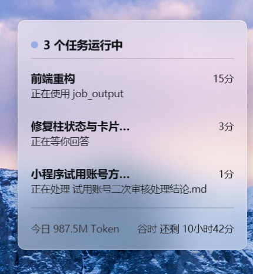
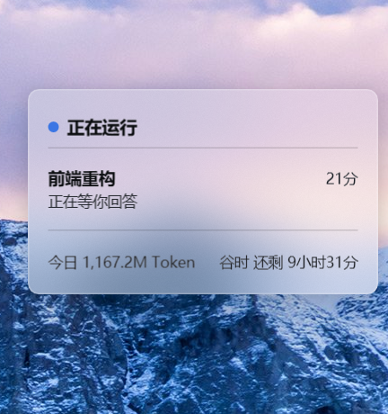
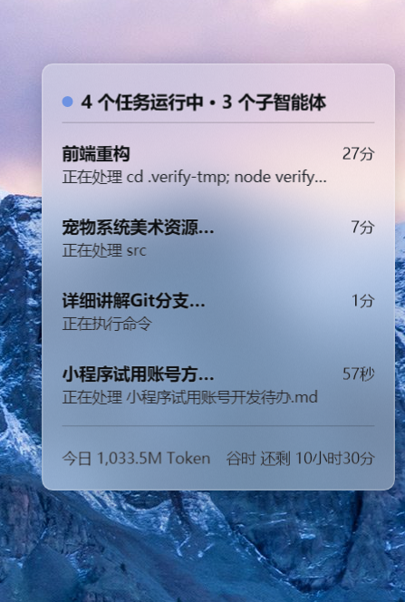
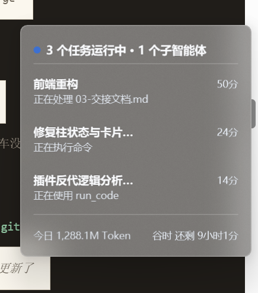
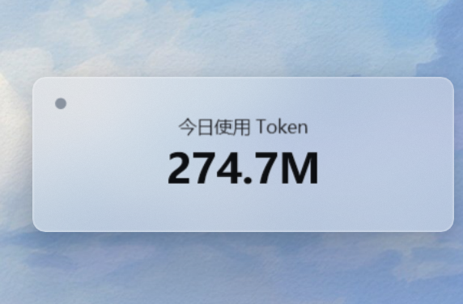
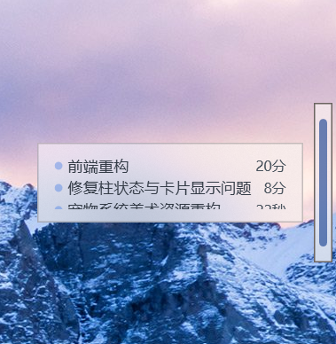
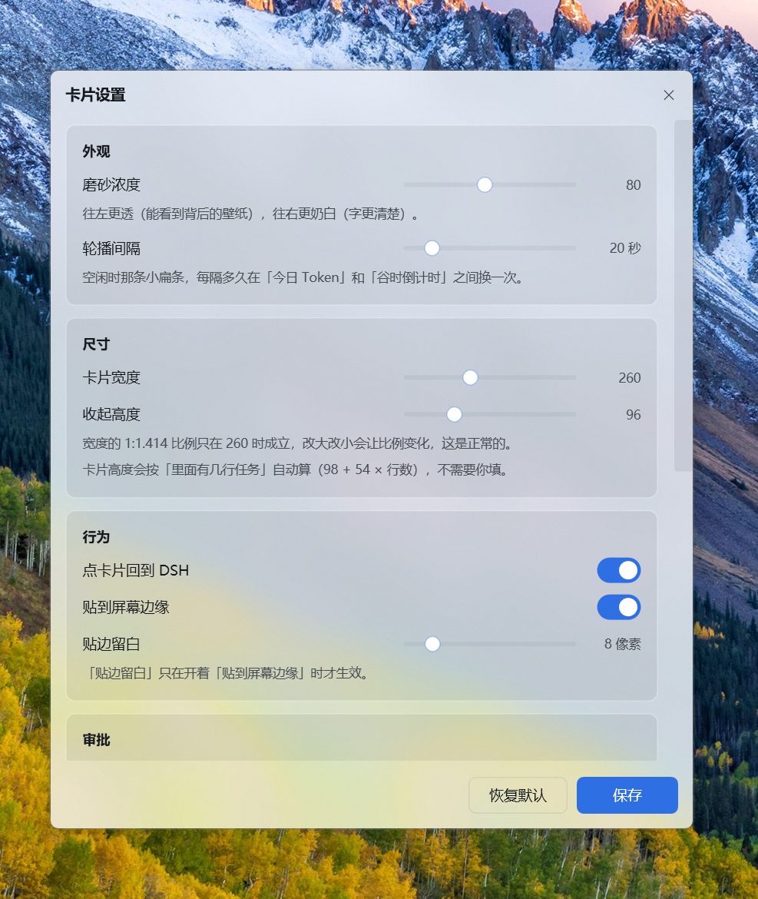
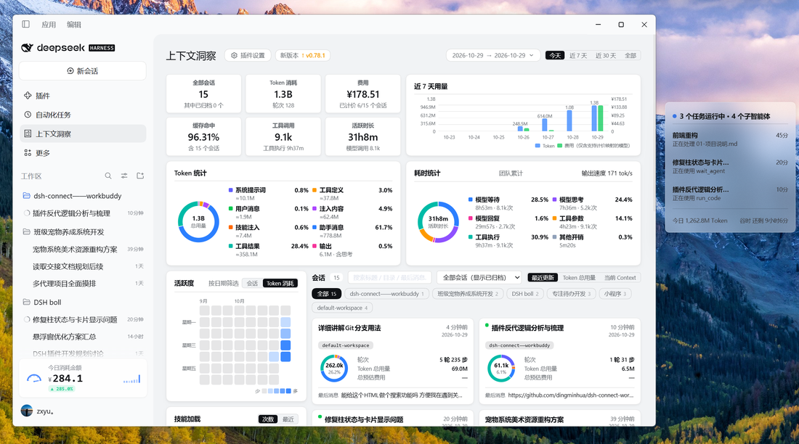

# 截图集

README 里只放了最能说明问题的几张，这里是完整版。

所有截图都是真机拍的、没有任何人工修饰（壁纸是用户自己的桌面）。
磨砂玻璃的实际观感会随壁纸变化，这是设计的一部分 —— 卡片会读取背后的明暗自动换文字颜色。

---

## 卡片态

### 多任务运行

3 个任务同时跑，每行显示任务名、已跑时间、正在做什么。
底部左边「今日 987.5M Token」是今天已经用掉的量；右边「谷时 还剩 10小时42分」
表示 DeepSeek 的低电价时段还剩多久 —— 这段时间用最便宜。

### 单任务运行

只有一个任务时，标题行直接变成「正在运行」，卡片也更矮。

### 子智能体

任务后面跟着「· N 个子智能体」时，说明这个任务在跑多代理协作。

### 深色壁纸

同一张卡片，壁纸一暗，文字自动从黑色换成白色。

### 空闲轮播

没有任务时卡片缩成一行，每隔一段时间在「今日 Token」和「谷时倒计时」之间换一次。
换的间隔可以在设置界面里调。

---

## 柱态（细柱）

### 柱子本体

14×120 像素，贴在屏幕边缘。中间那条色条表示状态：
蓝＝在跑、红＝等你审批、绿＝刚完成、灰＝空闲。

### 悬停气泡

鼠标移上去弹出气泡，显示每个任务的名字和已跑时长。

---

## 设置界面

右键卡片 → 设置…　改完点「保存」，卡片立刻生效（不用重启 DSH）。

---

## 全景

DSH 主界面 + 卡片浮在屏幕右侧。左边是用量统计，右边是实时任务。

